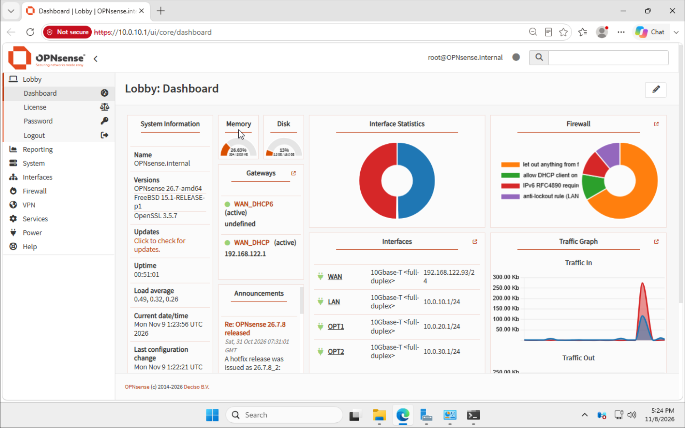
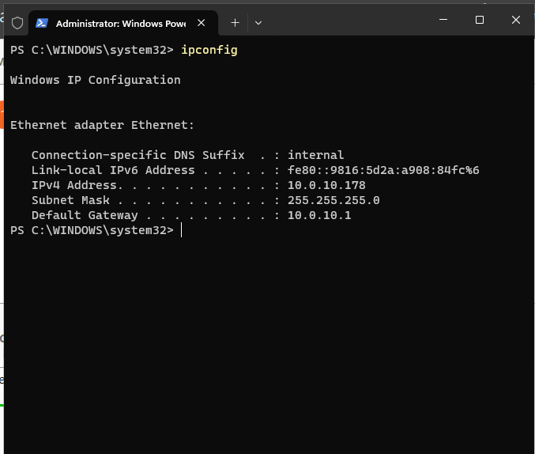
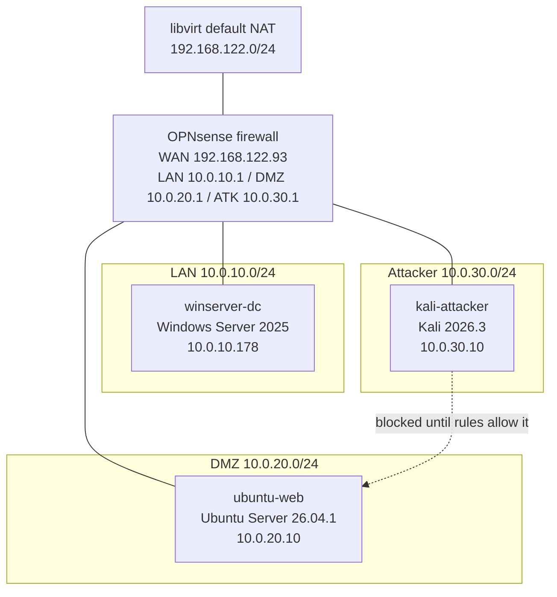

# Phase 1: Build the Network

**Security+ objectives:** 3.1 (architecture models), 3.2 (secure enterprise infrastructure)
**Goal:** Build a segmented small business network on a single host, with a firewall controlling traffic between zones.

## Environment

- **Host:** Framework 16 laptop, Ubuntu, 32 GB RAM, 1 TB NVMe, AMD-V enabled
- **Hypervisor:** KVM/QEMU with libvirt and virt-manager
- **Firewall:** OPNsense 26.7

## Progress

- [x] Install KVM and virt-manager
- [x] Create isolated virtual networks (lan, dmz, attacker)
- [x] Build OPNsense firewall VM
- [x] Assign interfaces and set IP addresses
- [x] Build Windows Server on `lan` (Active Directory comes in Phase 2)
- [x] Build Ubuntu web server on `dmz`
- [x] Build Kali Linux on `attacker`
- [ ] Write and test firewall rules

## Lab inventory

| VM | OS | Network | Address | Role |
|---|---|---|---|---|
| opnsense | OPNsense 26.7 | default, lan, dmz, attacker | 10.0.10.1, 10.0.20.1, 10.0.30.1 | Firewall and router |
| winserver-dc | Windows Server 2025 Standard (Desktop Experience) | lan | 10.0.10.178 (DHCP) | Future domain controller |
| ubuntu-web | Ubuntu Server 26.04.1 LTS | dmz | 10.0.20.10 (static) | Web server for DVWA |
| kali-attacker | Kali Linux 2026.3 | attacker | 10.0.30.10 (static) | Attacker |

## What I did

### 1. Install the virtualization stack

```
sudo apt install qemu-kvm libvirt-daemon-system libvirt-clients virt-manager bridge-utils
sudo usermod -aG libvirt,kvm $USER
```

Verified with `virsh list --all`.

### 2. Create isolated networks

Defined three layer-2 networks with no host IP and no DHCP, so the firewall controls all routing between them.

| Network | Subnet | Purpose |
|---|---|---|
| lan | 10.0.10.0/24 | Internal office systems |
| dmz | 10.0.20.0/24 | Public-facing web server |
| attacker | 10.0.30.0/24 | Kali, outside the trusted zones |


*Output of `virsh net-list --all` showing all networks active with autostart enabled.*

### 3. Build the firewall VM

- OPNsense with 4 virtio NICs, in this order: default (WAN/NAT), lan, dmz, attacker
- 2 vCPUs, 2 GB RAM, 20 GB disk, UFS install
- NIC order matters, because it decides which interface name (vtnet0 to vtnet3) each network gets


*`virsh domiflist opnsense` showing four virtio NICs attached to default, lan, dmz, and attacker.*

### 4. Assign interfaces and IPs

| Interface | NIC | Network | IP |
|---|---|---|---|
| WAN | vtnet0 | default (NAT) | DHCP, 192.168.122.93 |
| LAN | vtnet1 | lan | 10.0.10.1/24 |
| OPT1 (DMZ) | vtnet2 | dmz | 10.0.20.1/24 |
| OPT2 (Attacker) | vtnet3 | attacker | 10.0.30.1/24 |


*OPNsense console showing all four interfaces assigned.*


*OPNsense web GUI reached from the Windows Server VM on the lan network at 10.0.10.1.*

### 5. Build the remaining VMs

**Windows Server 2025 (lan).** 4 GB RAM, 2 vCPUs, 50 GB VirtIO disk, UEFI. The installer couldn't see the disk until I loaded the `viostor` driver from the virtio-win ISO, and I installed the rest of the VirtIO drivers (including the network adapter) from `virtio-win-gt-x64.msi` afterward. It received 10.0.10.178 from OPNsense's DHCP server and reaches the firewall GUI at https://10.0.10.1.


*Windows Server receiving 10.0.10.178 from OPNsense DHCP, with gateway 10.0.10.1.*

**Ubuntu Server 26.04.1 (dmz).** [2 GB RAM, 1 vCPU, 20 GB disk: confirm]. The installer could not get a DHCP lease on the DMZ, so I assigned a static address (10.0.20.10/24, gateway 10.0.20.1) and installed OpenSSH.

**Kali Linux 2026.3 (attacker).** [RAM and disk: confirm]. The installer also failed to get a DHCP lease, so I used a static address (10.0.30.10/24, gateway 10.0.30.1).

### 6. Firewall rules

OPNsense denies all traffic on optional interfaces until a rule allows it, so the DMZ and attacker networks started fully isolated. LAN has a default allow-all rule, which I'll tighten in Phase 2.

**Rules in place so far:**

| Interface | Action | Protocol | Source | Destination | Why |
|---|---|---|---|---|---|
| OPT1 (DMZ) | Pass | ICMP | OPT1 net | This firewall | Temporary: test DMZ connectivity to its gateway |


*Temporary ICMP rule on OPT1.*

**Planned rules (not yet written):**

| # | Source | Destination | Port | Action | Why |
|---|---|---|---|---|---|
| 1 | Attacker | DMZ web server | 80, 443 | Allow | Simulate outside users reaching the web server |
| 2 | Attacker | LAN | Any | Block (log) | Outsiders should never reach internal systems |
| 3 | LAN | DMZ | 80, 443, 22 | Allow | Staff and admins reach the web server |
| 4 | DMZ | LAN | Any | Block (log) | A compromised web server must not pivot inward |

### 7. Testing segmentation

| Test | Expected | Actual |
|---|---|---|
| DMZ host pings gateway before any rule | Blocked (default deny) | 100% packet loss |
| DMZ host pings gateway after ICMP rule | Replies | 3 of 3 replies, about 0.6 ms |
| Kali pings DMZ web server | Blocked (no rule allows it) | 100% packet loss |
| Kali reaches DMZ on ports 80/443 | Allowed once rules 1 is in place | [pending] |
| Kali scans LAN with Nmap | No response | [pending] |
| DMZ host connects to LAN | Blocked | [pending] |
| LAN reaches DMZ on port 80 | Success | [pending] |


*Ubuntu web server: ping fails under default-deny, then succeeds after the ICMP rule.*


*Kali at 10.0.30.10 cannot reach the DMZ web server at 10.0.20.10.*

## Backups

libvirt's built-in snapshots work on the OPNsense VM (`opnsense-gui-configured`), but not on UEFI VMs. For Windows Server I shut the VM down and copied its qcow2 disk as a baseline.

## Problems and fixes

**KVM warning in virt-manager: "KVM is not available"**

- **Symptom:** warning on the New VM screen; `/dev/kvm` didn't exist.
- **Diagnosis:** `lsmod | grep kvm` returned nothing, so the AMD KVM module wasn't loaded even though the CPU supported virtualization.
- **Fix:** `sudo modprobe kvm_amd`. It happened again after a reboot, so I made it permanent with `echo kvm_amd | sudo tee /etc/modules-load.d/kvm.conf`.

**"Emulator might not have search permissions" when loading the ISO**

- **Cause:** the QEMU process couldn't read files in my home directory.
- **Fix:** moved the ISOs to `/var/lib/libvirt/images/`, which libvirt can read.

**OPNsense installer RAM warning**

- **Cause:** the live installer wants about 3 GB; I had given the VM 2 GB.
- **Fix:** proceeded anyway. The install completed and OPNsense runs fine at 2 GB.

**VM booted back into the installer after the install**

- **Cause:** CD-ROM was first in the boot order.
- **Fix:** moved virtual disk to first in order over the CD-ROM

**virt-manager's OS list had no Ubuntu 26.04**

- **Cause:** the OS database is older than the release.
- **Fix:** chose Ubuntu 25.10 as the closest profile. It only sets default hardware hints.

**Windows installer showed no disk**

- **Cause:** Windows can't see VirtIO disks without a driver.
- **Fix:** loaded `viostor` from the virtio-win ISO during setup.

**`ipconfig /renew` error ("NCB is in use")**

- **Cause:** the VM already had its DHCP lease, so there was nothing to renew. Harmless.

**libvirt snapshot of the Windows VM failed**

- **Symptom:** "internal snapshots of a VM with pflash based firmware are not supported".
- **Cause:** the VM uses UEFI firmware.
- **Fix:** shut the VM down and copied its qcow2 disk file as a backup.

**DMZ and attacker hosts got no DHCP lease**

- **Symptom:** both the Ubuntu and Kali installers reported "autoconfiguration failed".
- **Cause:** OPNsense blocks all traffic on optional interfaces by default, including DHCP. Both failures had the same root cause.
- **Fix:** static addresses for both servers.

**DMZ host couldn't ping its gateway**

- **Cause:** same default-deny behavior.
- **Fix:** added a scoped ICMP rule on OPT1. Replies confirmed the rule worked, and showed that default-deny was doing its job before it.

## Result and takeaway

[Write 3-4 sentences once the phase is done: what you built, what you verified, and what you'd do differently. Mention why isolated networks with no host IP matter for a lab that will run attacks.]

## Diagram

![Network diagram]

