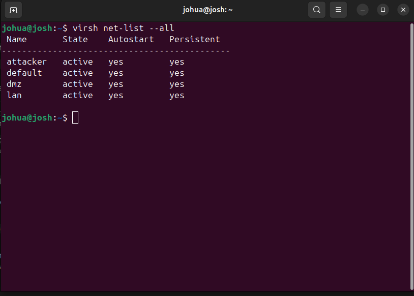
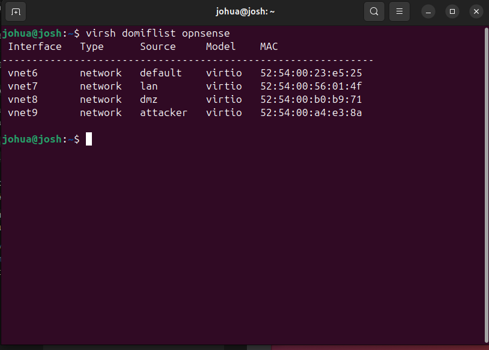
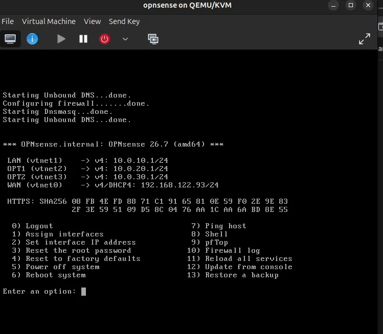

# Phase 1: Build the Network

**Security+ objectives:** 3.1 (architecture models), 3.2 (secure enterprise infrastructure)
**Goal:** Build a segmented small business network on a single host, with a firewall controlling traffic between zones.

## Environment

- **Host:** Framework 16 laptop, Ubuntu, 32 GB RAM, 1 TB NVMe, AMD-V enabled
- **Hypervisor:** KVM/QEMU with libvirt and virt-manager
- **Firewall:** OPNsense

## Progress

- [x] Install KVM and virt-manager
- [x] Create isolated virtual networks (lan, dmz, attacker)
- [x] Build OPNsense firewall VM
- [x] Assign interfaces and set IP addresses
- [ ] Build Windows Server (Active Directory) on `lan`
- [ ] Build Ubuntu web server on `dmz`
- [ ] Build Kali Linux on `attacker`
- [ ] Write and test firewall rules

## What I did

### 1. Install the virtualization stack
```
sudo apt install qemu-kvm libvirt-daemon-system libvirt-clients virt-manager bridge-utils
sudo usermod -aG libvirt,kvm $USER
```
Verified with `virsh list --all`.

### 2. Create isolated networks
Defined three layer-2 networks with no host IP and no DHCP, so the firewall controls all routing between them.

| Network | Subnet | Purpose |
|---|---|---|
| lan | 10.0.10.0/24 | Internal office systems |
| dmz | 10.0.20.0/24 | Public-facing web server |
| attacker | 10.0.30.0/24 | Kali, outside the trusted zones |


*[Caption: output of `virsh net-list --all` showing all networks active.]*

### 3. Build the firewall VM
- OPNsense with 4 virtio NICs, in this order: default (WAN/NAT), lan, dmz, attacker
- 2 vCPUs, 20 GB disk, UFS install
- [Note anything about the RAM or installer you want to mention.]



### 4. Assign interfaces and IPs
| Interface | NIC | Network | IP |
|---|---|---|---|
| WAN | vtnet0 | default (NAT) | DHCP, [192.168.122.x] |
| LAN | vtnet1 | lan | 10.0.10.1/24 |
| OPT1 (DMZ) | vtnet2 | dmz | 10.0.20.1/24 |
| OPT2 (Attacker) | vtnet3 | attacker | 10.0.30.1/24 |



### 5. Build the remaining VMs
[Fill in as you complete each: OS, RAM, network, IP, and a screenshot.]

### 6. Firewall rules
[Fill in once written. Use the table below.]

| # | Source | Destination | Port | Action | Why |
|---|---|---|---|---|---|
| 1 | Attacker | DMZ | 80, 443 | Allow | Simulate outside users reaching the web server |
| 2 | Attacker | LAN | Any | Block | Outsiders should never reach internal systems |
| 3 | LAN | DMZ | 80, 443, 22 | Allow | Staff and admins reach the web server |
| 4 | DMZ | LAN | Any | Block | A compromised web server must not pivot inward |
| 5 | [add more] | | | | |

### 7. Testing segmentation
[Record what you ran and what happened.]

| Test | Expected | Actual |
|---|---|---|
| Kali pings DMZ web server | Blocked or allowed per rules | |
| Kali scans LAN with Nmap | No response | |
| DMZ host connects to LAN | Blocked | |
| LAN reaches DMZ on port 80 | Success | |

## Problems and fixes

**KVM warning in virt-manager: "KVM is not available"**
- **Symptom:** warning on the New VM screen; `/dev/kvm` didn't exist.
- **Diagnosis:** `lsmod | grep kvm` returned nothing, so the AMD KVM module wasn't loaded even though the CPU supported virtualization.
- **Fix:** `sudo modprobe kvm_amd`, then made it persistent in `/etc/modules-load.d/kvm.conf`.

**"Emulator might not have search permissions" when loading the ISO**
- **Cause:** the QEMU process couldn't read files in my home directory.
- **Fix:** moved the ISO to `/var/lib/libvirt/images/`, which libvirt can read.

**OPNsense installer RAM warning**
- **Cause:** the live installer wants about 3 GB; I had given the VM 2 GB.
- **Fix:** [proceeded anyway / raised RAM to 4 GB. Say which.]

**VM booted back into the installer after the install**
- **Cause:** CD-ROM was first in the boot order.
- **Fix:** moved the virtual disk above the CD-ROM. [Confirm this is what you did.]

## Result and takeaway
[Write 3-4 sentences once the phase is done: what you built, what you verified, and what you'd do differently. Mention why isolated networks with no host IP matter for a lab that will run attacks.]

## Diagram

